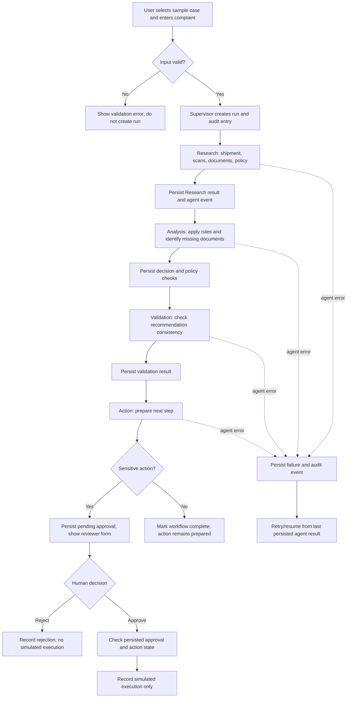
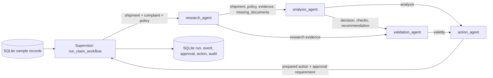

# ORBIT — Complete Project Guide

> **Scope and truthfulness:** This guide describes the code currently in this repository. ORBIT is a local demonstration that uses simulated shipment records and example policies. It does **not** connect to Delhivery, issue real refunds, create support tickets, call an AI model, or retrieve live shipment evidence. Its workflow, review records, and approval-gated actions are real application behavior; the carrier and action data are simulated.

## Table of contents

1. [Project overview](#1-project-overview)
2. [Problem and solution](#2-problem-and-solution)
3. [Complete workflow](#3-complete-workflow)
4. [Multi-agent architecture](#4-multi-agent-architecture)
5. [Technology stack](#5-technology-stack)
6. [File-by-file guide](#6-file-by-file-guide)
7. [Data and dataset](#7-data-and-dataset)
8. [Internal implementation](#8-internal-implementation)
9. [UI and features](#9-ui-and-features)
10. [APIs and integrations](#10-apis-and-integrations)
11. [Database and storage](#11-database-and-storage)
12. [Installation and execution](#12-installation-and-execution)
13. [Testing and evaluation](#13-testing-and-evaluation)
14. [Security and human oversight](#14-security-and-human-oversight)
15. [Example end-to-end execution](#15-example-end-to-end-execution)
16. [Limitations and future scope](#16-limitations-and-future-scope)
17. [Project demonstration guide](#17-project-demonstration-guide)
18. [Glossary and quick reference](#18-glossary-and-quick-reference)

---

## 1. Project overview

**Project name:** ORBIT  
**Target company/domain:** Delhivery shipment-claim handling  
**Project type:** Python web application and multi-stage workflow demonstration  
**Current operating mode:** Local demo; sample data; no external APIs required

### Purpose

ORBIT demonstrates how a shipment complaint can be reviewed through a consistent sequence: gather the available case evidence, compare it with a claim rule, validate the recommendation, and prepare a safe next step. It also demonstrates how a persistent review record and an explicit human approval checkpoint can make the process easier to inspect.

### Problem statement

A delivery complaint may involve multiple facts—such as route, tracking events, delay duration, delivery status, invoice availability, or damage photographs. A reviewer needs to collect those facts, check the relevant requirements, identify missing material, record a decision, and decide what should happen next. If those steps are performed inconsistently or without a history, it can be difficult to explain or audit the outcome.

### Objectives

- Make each stage of a claim review visible.
- Use explicit example rules rather than hide the decision in a black-box model.
- Identify absent required documents.
- Keep agent outputs, errors, decisions, approvals, and action results in SQLite.
- Require a persisted reviewer decision before an eligible sensitive action can be marked executed.
- Make clear that any execution in this demo is simulated.
- Provide a small, repeatable evaluation and tests for a college project demonstration.

### Real-world use case represented

A customer reports that a parcel is late, damaged, missing, or marked delivered without receipt. In a real logistics organization, a support reviewer might look up shipment scans and documents, apply the carrier's authoritative policy, then request more information, escalate, approve a remedy, or close a claim. ORBIT represents this review pattern with local sample records. It is **not** a production Delhivery claims tool.

---

## 2. Problem and solution

### The process problem

Claim investigations can involve information from different places and policy conditions that differ by complaint type. Common sources of confusion include:

- Treating a customer's description as proof of shipment events.
- Missing documents that are required before a decision.
- Applying the wrong threshold or overlooking a filing window.
- Advancing to a sensitive action without a recorded approval.
- Losing track of which stage failed or what evidence led to a recommendation.

### ORBIT's demonstration solution

ORBIT stores a small set of simulated Delhivery-style cases and policy examples locally. The supervisor passes one case through four deterministic stages:

1. **Research** assembles the shipment record, tracking events, available documents, and example policy.
2. **Analysis** applies visible rules to the structured shipment data and identifies eligibility or missing information.
3. **Validation** checks that an eligible recommendation is not in conflict with missing documents or failed policy checks.
4. **Action** prepares an appropriate next step. Sensitive refund and claim-closure actions wait for a recorded human decision.

The app saves intermediate state, events, approvals, actions, and audit entries in SQLite. A failed agent stage can be retried without re-running stages whose results were already saved.

**Important:** The complaint text is validated, stored, and passed to Research, but the current decision rules use the selected shipment's structured `claim_type`, document flags, and numeric evidence fields. There is no natural-language intent classifier or AI-generated interpretation.

---

## 3. Complete workflow

### Workflow diagram



### Step by step

1. **Select and submit.** The Streamlit sample-case selector can fill the shipment ID and complaint. The user can edit both. On **Review claim**, `start_claim_workflow()` trims the input, uppercases and validates the shipment ID against `DLV-` plus four digits, checks that the complaint is 10–1,000 characters, and looks up that shipment in SQLite.
2. **Create a run.** A UUID run ID is generated. The run begins in `processing`, and a `workflow_started` audit entry is recorded.
3. **Research.** `research_agent()` creates an evidence list and a missing-document list using the local shipment and policy records. Its complete return value is stored as the `research` part of the run's JSON state.
4. **Analysis.** `analysis_agent()` applies the branch for the claim type. It returns a decision, a human-readable recommendation, policy checks, failed checks, and missing documents.
5. **Validation.** `validation_agent()` returns individual consistency checks and a `valid` flag. If validation fails, the Action Agent prepares `hold_for_review` rather than a refund or closure.
6. **Prepare action.** `action_agent()` maps a valid result to a next step. Eligible claims prepare `issue_refund`; ineligible claims prepare `close_claim`; missing evidence prepares `request_documents`; delivery disputes that need investigation prepare `manual_investigation`. The first two require approval. Preparing a request or investigation does **not** send anything.
7. **Save final workflow state.** ORBIT writes an action row, an approval row (`pending` or `not_required`), processing time, the result state, and audit entries. Runs that need approval have status `awaiting_approval`; otherwise the workflow is `completed`, even though a non-sensitive action may only be prepared.
8. **Review approval.** A reviewer chooses `approved` or `rejected`, enters a reviewer name, and may add a note. `decide_approval()` validates the inputs and verifies that the run, approval, and sensitive action are still pending.
9. **Complete safely.** Approval is persisted before `_execute_simulated_action()` checks the recorded approval and pending action. On approval it records `simulated_executed`; no external service is called. Rejection records `rejected` and never marks the action executed.
10. **Inspect or retry.** Review history reloads prior runs from SQLite. A failed run displays its error and offers **Retry / resume saved workflow**. `resume_claim_workflow()` continues from saved intermediate state.

### Actual inter-agent data handoff

The current pipeline is sequential and runs in the Streamlit process. It does not use a message broker, concurrent agent workers, or a LangChain graph.



---

## 4. Multi-agent architecture

“Agent” in this project means a focused Python function with a defined input and output. These agents are deterministic functions; they do not call a language model or autonomously choose tools.

| Component | Implemented responsibility | Inputs | Output / handoff |
| --- | --- | --- | --- |
| **Supervisor** (`pipeline.py`) | Validates a request, creates the run, calls each agent in order, saves checkpoints and events, handles errors, and coordinates approvals. | Shipment ID, complaint, optional database path, and (for tests) an optional fault injector. | Persisted run details, including all completed stage results and status. |
| **Research Agent** (`research_agent`) | Retrieves evidence from the selected local shipment and policy records, and calculates missing required documents. | Shipment mapping, complaint string, policy mapping. | `shipment`, `complaint`, `policy`, `evidence`, `missing_documents`. |
| **Analysis Agent** (`analysis_agent`) | Applies the rules for the structured claim type; produces policy checks and a recommendation. | Research result. | `decision`, `recommendation`, `policy_checks`, `failed_checks`, `missing_documents`. |
| **Validation Agent** (`validation_agent`) | Checks consistency between missing documents, failed rules, and the proposed decision. | Research and analysis results. | `valid`, named boolean checks, and an explanatory message. |
| **Action Agent** (`action_agent`) | Prepares—but does not send—a suitable next step and determines whether approval is required. | Analysis and validation results. | `action_type`, `requires_approval`, initial `status`, and description. |

### Decision names used by code

| Decision | Meaning in this demo | Prepared action |
| --- | --- | --- |
| `eligible` | Required documents are present and implemented checks pass. | `issue_refund`; approval required; simulated execution only after approval. |
| `ineligible` | At least one implemented threshold check failed. | `close_claim`; approval required; simulated execution only after approval. |
| `needs_documents` | One or more required document flags are false. | `request_documents`; prepared only, not sent. |
| `investigation_required` | Delivery dispute is not automatically adjudicated. | `manual_investigation`; prepared only, no ticket created. |

If Validation finds an inconsistency, Action instead prepares `hold_for_review`. That branch is present in code but is not one of the six sample cases' expected outcomes.

---

## 5. Technology stack

| Technology | Status | Why it is used |
| --- | --- | --- |
| **Python** | Implemented | Application, agent rules, persistence coordination, evaluation, and tests. The README specifies Python 3.10 or newer. |
| **Streamlit** | Implemented | Renders the dashboard, forms, tabs, metrics, approval controls, and history. It reruns the Python app as users interact. |
| **SQLite** | Implemented | Local relational database for seed data, run state, events, approvals, actions, and audit entries. |
| **`sqlite3`** | Implemented; Python standard library | Opens SQLite connections and executes schema and data queries. No separate database server is required. |
| **`python-dotenv`** | Implemented | Loads local `.env` configuration for `ORBIT_DB_PATH`. |
| **`unittest`** | Implemented; Python standard library | Runs workflow tests without a separate test framework dependency. |
| **`tempfile`, `pathlib`, `uuid`, `time`, `json`, `re`, `datetime`** | Implemented; Python standard library | Temporary evaluation/test databases, filesystem paths, run IDs, timings, JSON persistence, input-format validation, and UTC timestamps. |
| **HTML/CSS in `app.py`** | Implemented | Styles the Streamlit dashboard. The app uses local system font stacks and does not need a remote font service. |
| **Git ignore conventions** | Configuration only | `.gitignore` excludes local environments, secrets, caches, and SQLite data files. |

`requirements.txt` currently declares only `streamlit>=1.36.0` and `python-dotenv>=1.0.0`. There is no pandas, LangChain, Groq, Tavily, model SDK, web-scraping package, or external service client in the active implementation.

---

## 6. File-by-file guide

The following inventory covers the maintained root files and test file. `.venv/`, `__pycache__/`, and bytecode are generated environment/runtime files, not application source.

| File or folder | Purpose and important contents | Data and connections |
| --- | --- | --- |
| [`app.py`](./app.py) | Streamlit entry point. Sets the page theme, initializes SQLite, renders the sidebar, evaluation, case selector, complaint form, history, run summary, evidence/policy, agent events, approval/action controls, and audit history. Helper functions: `_case_label`, `_format_duration`, `_load_selected_case`, `_on_history_change`, `_render_evaluation`. | Reads cases and run details through `storage.py`; submits to and approves/resumes through `pipeline.py`; invokes `evaluation.py`. |
| [`pipeline.py`](./pipeline.py) | Supervisor orchestration and action authorization. Defines `WorkflowError`, `_insert_audit`, `run_claim_workflow`, `resume_claim_workflow`, `start_claim_workflow`, `_execute_simulated_action`, `execute_simulated_action`, and `decide_approval`. | Calls agents from `agents.py`; writes/reads state using `storage.py`; returns run-detail mappings. |
| [`agents.py`](./agents.py) | Four deterministic agent functions: `research_agent`, `analysis_agent`, `validation_agent`, and `action_agent`. | Accepts mappings for shipment, policy, research, analysis, and validation. Returns dictionaries consumed by the next stage and saved in run state. |
| [`sample_data.py`](./sample_data.py) | Tuples `SHIPMENTS` and `POLICIES`, plus `EXPECTED_DECISIONS` for the six-case evaluation. All values are explicitly simulated examples. | Imported by `storage.py`, `evaluation.py`, and tests. |
| [`storage.py`](./storage.py) | SQLite connection and schema management: `utc_now`, `get_db_path`, `connect`, `initialize_database`, `list_shipments`, `get_shipment`, `get_policy`, `list_runs`, and `get_run_details`. | Seeds records from `sample_data.py`; exposes JSON-decoded records to the app, pipeline, and evaluation. |
| [`evaluation.py`](./evaluation.py) | `run_evaluation()` calculates same-dataset decision and evidence metrics, processing timings, one retry check, and one unauthorized-action check. | Calls agents and pipeline functions; uses a temporary SQLite database for recovery and approval checks. |
| [`tests/test_orbit.py`](./tests/test_orbit.py) | Seven `unittest` cases covering all sample decisions, evidence, approval, rejection, resume, input validation, and evaluation metrics. | Creates a separate temporary database for each test. |
| [`requirements.txt`](./requirements.txt) | Runtime dependencies and minimum versions. | Installed into the active Python environment with pip. |
| [`.env.example`](./.env.example) | Safe configuration template containing only `ORBIT_DB_PATH=orbit_data.db`. | Copy to `.env` if desired; no API credentials are needed. |
| [`.env`](./.env) | Local environment configuration, ignored by Git. This guide intentionally does not inspect or reproduce its contents. | `storage.py` calls `load_dotenv()` and reads `ORBIT_DB_PATH`. |
| [`.gitignore`](./.gitignore) | Excludes `.env`, virtual environments, caches, generated files, and local SQLite databases. | Protects local-only material from normal Git tracking. |
| [`orbit_data.db`](./orbit_data.db) | Local SQLite runtime database present in the project folder. `initialize_database()` creates its schema and seeds sample records. It is ignored by Git. | Default persistent database when no other path is configured. |
| [`README.md`](./README.md) | Concise overview, setup, run, test, evaluation summary, and project layout. | Complements this detailed guide. |
| [`AboutProject.md`](./AboutProject.md) | This architecture, implementation, operation, and demonstration guide. | Documentation only; does not change runtime behavior. |

### Function reference

| Function or class | Module | What it does |
| --- | --- | --- |
| `WorkflowError` | `pipeline.py` | Exception carrying a `run_id` so the UI can display and resume a failed persisted run. |
| `start_claim_workflow(shipment_id, complaint, db_path=None, fault_injector=None)` | `pipeline.py` | Validates input, inserts a `processing` run and start audit event, then invokes the supervisor workflow. |
| `run_claim_workflow(run_id, db_path=None, fault_injector=None)` | `pipeline.py` | Runs missing agent stages in order; persists stage checkpoints; returns complete details. |
| `resume_claim_workflow(run_id, db_path=None)` | `pipeline.py` | Calls the workflow runner to continue a failed run from the last saved stage. |
| `decide_approval(run_id, decision, reviewer, note="", db_path=None)` | `pipeline.py` | Validates a pending approval and records approval or rejection; approved actions are simulated. |
| `execute_simulated_action(run_id, db_path=None)` | `pipeline.py` | Attempts the guarded action operation; rejects it unless the action needs approval and persisted approval is `approved`. |
| `_execute_simulated_action(connection, run_id)` | `pipeline.py` | Enforces the approval and pending-action checks, then records `simulated_executed` and an audit event. |
| `initialize_database(db_path=None)` | `storage.py` | Creates tables/indexes and inserts any missing sample shipment and policy rows. |
| `get_run_details(run_id, db_path=None)` | `storage.py` | Loads a run and its events, approval, action, and ordered audit history, decoding stored JSON fields. |
| `run_evaluation()` | `evaluation.py` | Returns a dictionary of evaluation results and per-case comparisons for the dashboard and tests. |
| `research_agent(shipment, complaint, policy)` | `agents.py` | Returns the shipment/policy context, evidence list, and missing document names. |
| `analysis_agent(research)` | `agents.py` | Returns a structured decision, recommendation, checks, and missing documents. |
| `validation_agent(research, analysis)` | `agents.py` | Returns a boolean validity result, individual consistency checks, and a message. |
| `action_agent(analysis, validation)` | `agents.py` | Returns a prepared action type, approval flag, initial status, and description. |
| `utc_now()` / `get_db_path(db_path=None)` / `connect(db_path=None)` | `storage.py` | Provide UTC timestamps, resolve the configured DB path, and open a commit/rollback-managed SQLite connection. |
| `list_shipments(db_path=None)` / `get_shipment(shipment_id, db_path=None)` / `get_policy(claim_type, db_path=None)` | `storage.py` | Return decoded sample records from their respective tables. |
| `list_runs(db_path=None, limit=50)` | `storage.py` | Returns a bounded, newest-first list of run summary fields. |
| `_case_label(case)` / `_format_duration(milliseconds)` | `app.py` | Format a sample case for the selector and format evaluation durations. |
| `_load_selected_case()` / `_on_history_change()` | `app.py` | Update Streamlit session selection from the selected sample or history dropdown. |
| `_render_evaluation()` | `app.py` | Calls the evaluation function and renders metrics, baseline comparison, and case results. |
| `OrbitWorkflowTests` and its `test_*` methods | `tests/test_orbit.py` | Set up a temporary DB and assert decisions, evidence, safety, resume, validation, and evaluation behavior. |

---

## 7. Data and dataset

### Source and status

**All shipment records, tracking strings, document-presence flags, policy summaries, and expected outcomes are local simulated educational data** defined in `sample_data.py`. They are not fetched from Delhivery, customer systems, or an external dataset. The “policy” summaries and thresholds are not official Delhivery rules.

The application stores the sample shipment and policy objects as JSON text in SQLite. To seed an empty database, `initialize_database()` uses `INSERT OR IGNORE`; if an ID/type already exists, editing the Python tuple does not overwrite that database record. To see modified seed values, configure a new database path or deliberately reset the local demo database after backing up anything you need.

### Shipment fields

Each object in `SHIPMENTS` contains:

| Field | Example | Meaning |
| --- | --- | --- |
| `shipment_id` | `DLV-2401` | Demo identifier. It is not a live AWB lookup key. |
| `status` | `Delayed in transit` | Display label for the simulated record. |
| `origin`, `destination` | `Bengaluru`, `New Delhi` | Demo route. |
| `claim_type` | `delay` | Selects which local policy/rule branch applies: `delay`, `damage`, `lost`, or `not_received`. |
| `complaint` | “My parcel is nine days late…” | Starter text shown by the UI; user can edit it. |
| `delay_days` | `9` | Structured transit-delay value read by the delay rule. |
| `claim_age_days` | `2` | Structured age used by the delay filing-window rule. |
| `days_since_last_scan` | `14` | Structured inactivity used by the lost-shipment rule. |
| `damage_reported_days_ago` | `2` | Structured time used by the damage-reporting rule. |
| `delivered` | `False` | Display information; it is not by itself a universal decision rule. |
| `documents` | `{"invoice": true, ...}` | Boolean availability flags. A `false` or absent required key counts as missing. |
| `tracking_events` | `["2026-10-07: ..."]` | Local display/evidence strings; no timestamps are parsed from them to determine thresholds. |

### Included sample cases

| ID | Claim type | Example scenario | Expected decision |
| --- | --- | --- | --- |
| `DLV-2401` | `delay` | Nine days late; invoice and tracking history present. | `eligible` |
| `DLV-2402` | `damage` | Damage reported two days after delivery; invoice and photos present. | `eligible` |
| `DLV-2403` | `not_received` | Delivery disputed; proof of delivery absent. | `needs_documents` |
| `DLV-2404` | `delay` | Three-day delay; threshold is seven days. | `ineligible` |
| `DLV-2405` | `lost` | No scan for fourteen days; invoice and tracking present. | `eligible` |
| `DLV-2406` | `damage` | Damage reported promptly; damage photos absent. | `needs_documents` |

### Policy fields and implemented thresholds

Each object in `POLICIES` has `claim_type`, `title`, `required_documents`, `summary`, and a type-specific numeric threshold:

| Claim type | Required document flags | Rule implemented by Analysis |
| --- | --- | --- |
| `delay` | `invoice`, `tracking_history` | `delay_days >= minimum_delay_days` (7) and `claim_age_days <= maximum_claim_age_days` (30). |
| `damage` | `invoice`, `damage_photos` | `damage_reported_days_ago <= maximum_report_days` (7). |
| `lost` | `invoice`, `tracking_history` | `days_since_last_scan >= minimum_no_scan_days` (10). |
| `not_received` | `invoice`, `tracking_history`, `proof_of_delivery` | Proof of delivery is required for human investigation. Missing required evidence results in `needs_documents`; the code does not automatically adjudicate this type. |

The Research Agent marks a required document missing when `documents.get(name, False)` is false. Existing document flags are not file attachments—only simulated availability indicators.

### Adding or changing a sample

1. Edit or add an object in `SHIPMENTS` in `sample_data.py`, keeping every field required by the relevant analysis branch.
2. Add or update the corresponding object in `POLICIES`; the policy's `claim_type` must match the shipment. Supply its required-document list and the correct threshold key used by `analysis_agent()`.
3. Add the shipment's expected decision to `EXPECTED_DECISIONS` if it should participate in evaluation.
4. Update or add tests in `tests/test_orbit.py` to check the intended outcome.
5. Use a fresh database file (for example set `ORBIT_DB_PATH=orbit_evaluation.db`) if that shipment ID or claim type has already been seeded; seeding does not overwrite existing records.
6. Run `python -m unittest discover -s tests -v` and check the evaluation dashboard.

---

## 8. Internal implementation

### Agent rules

There are **no prompts, model calls, vector search, embeddings, or autonomous tool calls** in the current code. `agents.py` functions execute Python logic directly:

- `research_agent()` copies the shipment and policy mappings, builds evidence entries for the shipment record, each tracking event, each available document, and the policy, then lists missing required documents.
- `analysis_agent()` chooses a branch using `shipment["claim_type"]`, builds named pass/fail/pending checks, then prioritizes decisions in this order: any failed check → `ineligible`; else any missing documents → `needs_documents`; else delivery dispute → `investigation_required`; otherwise → `eligible`.
- `validation_agent()` verifies three narrow invariants: an eligible result cannot have missing documents; an eligible result cannot have failed checks; and a `needs_documents` result must actually identify missing evidence.
- `action_agent()` first handles invalid validation as `hold_for_review`; otherwise it maps the decision to an action type and approval requirement.

### Supervisor state and checkpoints

The shared run state is a JSON object saved to `runs.state_json`. As each stage completes, a key is added:

```json
{
  "research": {
    "shipment": {"shipment_id": "DLV-2401"},
    "complaint": "My parcel is nine days late...",
    "policy": {"claim_type": "delay"},
    "evidence": [{"kind": "shipment_record", "label": "Simulated Delhivery shipment record"}],
    "missing_documents": []
  },
  "analysis": {
    "decision": "eligible",
    "recommendation": "The available evidence meets the recorded demo policy checks.",
    "policy_checks": [],
    "failed_checks": [],
    "missing_documents": []
  },
  "validation": {"valid": true, "checks": [], "message": "Recommendation is consistent with the evidence."},
  "action": {"action_type": "issue_refund", "requires_approval": true, "status": "awaiting_approval"},
  "execution_notice": "Simulation only. No Delhivery shipment, refund, support ticket, or external system was changed."
}
```

This is a shortened illustrative shape; real `evidence` and `policy_checks` contain full entries. The function writes each successful stage result immediately. A later run skips any stage key already present, making it possible to resume at the point of failure.

### Status values

- **Workflow:** initially `processing`; then `failed`, `awaiting_approval`, or `completed`.
- **Approval:** `pending`, `approved`, `rejected`, or `not_required`.
- **Action:** initially a prepared status such as `awaiting_approval` or `prepared`; after reviewer rejection `rejected`; after a successful approved simulation `simulated_executed`.
- **Agent event:** `running`, `completed`, or `failed`.

The UI displays recorded state. The workflow is synchronous: users see stage history after the run returns, rather than a streamed live progress animation.

### Failure handling and recovery

Before an agent call, the supervisor inserts a `running` event. If the agent raises an exception, the supervisor updates that event to `failed`, saves the error and accumulated time on the run, adds an `agent_failed` audit entry, and raises `WorkflowError` containing the run ID. The UI can then retry. Resume records `workflow_resumed`, clears the run-level error, and continues from saved state. A failure-injection callback exists for reproducible tests/evaluation; it is not exposed as a normal UI control.

SQLite transactions are managed by `storage.connect()`: on normal exit the connection commits; on an exception it rolls back and closes. The approval/rejection and action update are performed within the same connection transaction.

### Approval and simulated execution

The guarded execution helper checks all of the following before marking an action executed:

1. There is an action row and an approval row for the run.
2. The action is marked as requiring approval.
3. The stored approval status is exactly `approved`.
4. The action is still `awaiting_approval`.

Only then does it set action status to `simulated_executed`, update the run, and append a `simulated_action_executed` audit entry. The result text explicitly states that no Delhivery system, shipment, refund, or support ticket changed.

### Time measurement

The workflow records `processing_ms` using Python's `time.perf_counter()`, rounded to milliseconds, for agent processing. It does not include human waiting time. Evaluation separately measures the four direct in-process agent calls and an extremely small “always eligible” baseline decision. These values are local microbenchmarks—not a production throughput or fair end-to-end service comparison.

---

## 9. UI and features

The entire user interface is rendered by `app.py` as one Streamlit page.

| UI area/control | What the user sees or does | What the code does |
| --- | --- | --- |
| **Sidebar: ORBIT and workflow** | Shows the four stages and their intended responsibilities. | Static explanation of the implemented sequence. |
| **System mode** | Shows “Local demo data · no carrier integration” and the active SQLite filename. | Uses `get_db_path()`; makes the simulated-only boundary explicit. |
| **Refresh dashboard** | Re-renders the dashboard. | Calls `st.rerun()`; it does not reset or delete stored data. |
| **Header and demo badge** | Presents the purpose and a prominent simulated-data notice. | Static page markup/CSS. |
| **Evaluation dashboard** | Expandable metrics and per-case comparison. | Calls `run_evaluation()` and displays its current calculations; safety/recovery checks use a temporary database. |
| **Load a sample case** | Dropdown of shipment ID, claim type, and route. | `_load_selected_case()` populates the editable shipment ID and complaint fields from that sample record. |
| **Shipment / AWB ID** | Editable ID, up to 16 characters. | Passed to `start_claim_workflow()`, where the exact `DLV-0000` shape and actual local record are validated. It is not sent to a live AWB API. |
| **Customer complaint** | Editable text, 10–1,000 characters for submission. | Trimmed and persisted. It is not parsed by a language model to infer claim type. |
| **Review claim** | Starts a new review. | Calls `start_claim_workflow()` and selects the returned run. Validation errors are shown; a `WorkflowError` selects the saved failed run and displays retry guidance. |
| **Selected shipment preview** | Shows simulated status, route, claim type, and available document flags. | Reads the case record from the local database. |
| **Review history** | Dropdown of up to 50 recent runs. | `list_runs()` reads persisted runs; changing the dropdown selects a run for display. |
| **Run metrics** | Workflow status, decision, prepared action, recorded processing milliseconds. | Values are read from the selected SQLite run; they are not progress estimates. |
| **Retry / resume saved workflow** | Appears for a failed run. | Calls `resume_claim_workflow()` and displays any subsequent failure explicitly. |
| **Recommendation and approval warning** | Shows the saved recommendation and warns when human action is pending. | Uses persisted run/action status. |
| **Overview tab** | Complaint, shipment status, route, claim type, delivery flag, recommendation, simulation notice. | Reads the current run state and corresponding local sample record. |
| **Evidence & policy tab** | Missing documents, evidence cards, policy-check table, validation result. | Renders Research/Analysis/Validation data saved in `state_json`. |
| **Agent activity tab** | Agent name, event status, event message, timestamp, and stage details/error. | Reads ordered `agent_events`; icons are derived from the stored event status. |
| **Approvals & actions tab** | Action type, simulation indicator, status, reviewer form, saved decision/note. | Pending actions can be approved/rejected by `decide_approval()`. Approval is not an external integration. |
| **Audit history tab** | UTC time, event name, and explanatory message. | Reads chronological `audit_entries`. |

### Status indicators

The dashboard differentiates workflow status, eligibility decision, action status, approval status, and agent event status. They are separate concepts: for example, an eligible claim can be `awaiting_approval` while its prepared action is `awaiting_approval`; a request for documents can have a completed workflow while its action remains only `prepared`.

---

## 10. APIs and integrations

### Implemented endpoints and network services

**No custom REST/HTTP API endpoints are implemented.** The application is served by Streamlit's own local web server when started with `python -m streamlit run app.py`. The code contains no Delhivery endpoint, payment endpoint, support-ticket endpoint, outbound HTTP client, webhook, or authentication integration.

| Integration | Status | Details |
| --- | --- | --- |
| Delhivery shipment/tracking API | **Planned; not implemented** | Sample shipment data is read from SQLite. |
| Delhivery policies or claims system | **Simulated** | Example policies live in `sample_data.py`; they are not official policy documents. |
| LLM / language model | **Not implemented** | No prompts or model SDK calls are present. |
| Search, scraping, vector database, or external retrieval | **Not implemented** | “Research” reads the local record; it does not search the web or retrieve a document from a real system. |
| Refund/payment service | **Simulated** | An approved action records `simulated_executed` in SQLite only. |
| Customer-support ticket service | **Not implemented** | `manual_investigation` is a prepared local action; no ticket is created. |
| External service credentials/API keys | **Not required** | There are no API key variables in the current app. |

### Environment variables

| Variable | Required? | Meaning |
| --- | --- | --- |
| `ORBIT_DB_PATH` | No | SQLite filename/path. Default: `orbit_data.db`. Relative paths are resolved from the project directory by `get_db_path()`. |

`python-dotenv` loads `.env` configuration in `storage.py`. The example file contains only the database-path setting. Never place real credentials in source code; future integrations should use secret configuration and should be documented separately.

---

## 11. Database and storage

### Location and format

The persistence layer is SQLite, a file-based database. The default path is the project-local `orbit_data.db`; `ORBIT_DB_PATH` can select another path. It does not require PostgreSQL, a server process, or a migration service. `initialize_database()` creates tables and indexes if absent, then seeds missing sample shipments and policies.

### Tables

| Table | Important columns | Purpose |
| --- | --- | --- |
| `shipments` | `shipment_id` (primary key), `record_json` | Stores each simulated shipment as JSON text. |
| `policies` | `claim_type` (primary key), `policy_json` | Stores each simulated policy as JSON text. |
| `runs` | `run_id` (primary key), `shipment_id` (foreign key), `complaint`, `status`, `decision`, `recommendation`, action/approval fields, `processing_ms`, `error`, `state_json`, timestamps | One row for each submitted review; `state_json` contains the cumulative agent checkpoints. |
| `agent_events` | autoincrement `event_id`, `run_id` (foreign key), `agent`, `status`, `message`, `details_json`, timestamp | Ordered record of each agent start, completion, or failure. |
| `approvals` | autoincrement `approval_id`, unique `run_id` (foreign key), `status`, `reviewer`, `note`, requested/decision timestamps | Human decision record, or `not_required`. |
| `actions` | autoincrement `action_id`, unique `run_id` (foreign key), `action_type`, `requires_approval`, `status`, `simulation`, `result`, timestamps | Prepared and simulated execution outcome. |
| `audit_entries` | autoincrement `audit_id`, `run_id` (foreign key), `event_type`, `message`, `details_json`, timestamp | Chronological high-level workflow and decision history. |

Indexes support recent-run ordering and loading per-run agent events and audit entries. `connect()` enables SQLite foreign-key enforcement and commits or rolls back a transaction.

### Data flow and retention

`sample_data.py` → `initialize_database()` → `shipments`/`policies` → Research → per-stage JSON checkpoint in `runs.state_json` → final run/action/approval/event/audit records → `get_run_details()` → dashboard.

The application does not define an automated retention period, export, user account, or database cleanup function. Run history remains in the configured database until an operator intentionally removes the local file or data.

---

## 12. Installation and execution

### Prerequisites

- Windows PowerShell (commands below use Windows paths).
- Python 3.10 or newer, according to the project README.
- Internet access only to install Python dependencies if they are not already installed. ORBIT itself does not need a carrier API or API key.

### Setup and run

From the project directory:

```powershell
Set-Location 'C:\Users\whoan\Desktop\Orbit_Project\Multi-Agent-System-main'
py -m venv .venv
.\.venv\Scripts\Activate.ps1
python -m pip install --upgrade pip
python -m pip install -r requirements.txt
if (-not (Test-Path .env)) { Copy-Item .env.example .env }
python -m streamlit run app.py
```

Open the local URL Streamlit prints (typically `http://localhost:8501`). A different port can be selected with Streamlit's command-line options, for example `python -m streamlit run app.py --server.port 8510`.

### Tests

```powershell
python -m unittest discover -s tests -v
```

### Common issues

| Symptom | Check or remedy |
| --- | --- |
| PowerShell refuses `Activate.ps1` | For the current PowerShell process only, run `Set-ExecutionPolicy -Scope Process -ExecutionPolicy Bypass`, then activate again. |
| `streamlit` cannot be imported | Activate the intended `.venv` and run `python -m pip install -r requirements.txt`. |
| The app says it cannot open the database | Check that the configured database directory exists or is writable; inspect `ORBIT_DB_PATH` and the displayed database error. |
| A complaint is rejected | Confirm the ID exactly follows `DLV-0000`, exists in the local sample database, and complaint length is 10–1,000 characters. |
| Changed sample data does not appear | Existing seed IDs are preserved by `INSERT OR IGNORE`. Use a new database path for revised local seed records. |
| A refund or closure does not execute | That is expected before approval. Record a reviewer decision; even approval only records a simulation. |
| The evaluation processing number changes | The metric is a local microbenchmark and varies with runtime and machine load. |

---

## 13. Testing and evaluation

### Automated tests

`tests/test_orbit.py` contains seven standard-library `unittest` methods:

1. `test_all_sample_cases_match_expected_decisions` — all six expected decisions and four completed agent events per run.
2. `test_evidence_and_missing_documents_are_persisted` — tracking evidence, missing proof of delivery, `needs_documents`, and successful validation.
3. `test_sensitive_action_is_blocked_until_human_approval` — action remains pending before approval and becomes simulated only after approval.
4. `test_rejected_sensitive_action_is_not_executed` — rejection does not add a simulated-execution event.
5. `test_failed_run_resumes_from_persisted_agent_result` — injected analysis failure, persisted Research output, resume, and no duplicate Research completion.
6. `test_input_validation_happens_before_a_run_is_created` — bad ID, short complaint, and unknown shipment do not create a run.
7. `test_evaluation_reports_baseline_and_safety_results` — core accuracy, evidence, recovery, and authorization metrics.

Tests and evaluation use temporary directories and databases so their generated records do not pollute the normal project database.

### Baseline and metrics

The baseline is intentionally simple: if the complaint is non-empty, predict `eligible`; retrieve no evidence; provide no recovery path; and provide no approval gate. It is a didactic comparison, not an industry benchmark.

| Metric | How the code calculates it | Interpretation and caveat |
| --- | --- | --- |
| Decision accuracy | Count predictions equal to `EXPECTED_DECISIONS`, divided by six cases, times 100. | The expected labels are written in the same sample-data module; six cases are too few to establish production accuracy. |
| Evidence completeness | Total entries returned by Research divided by the count of expected entries (one shipment record + each tracking event + each present document + one policy), times 100. | Measures coverage of the defined local fixture, not the correctness or completeness of real-world evidence. Baseline is 0 because it retrieves none. |
| Mean processing time | `time.perf_counter()` duration for direct Research→Analysis→Validation→Action calls, averaged across six cases. Baseline times its simple decision expression. | Local code timing only. Baseline measures much less work, so a lower number is expected and not an apples-to-apples service performance comparison. |
| Failure recovery | Inject one exception before the analysis stage; check that Research was saved and resume reaches `awaiting_approval`. | One successful recovery scenario; not exhaustive resilience testing. Baseline has no retry support. |
| Unauthorized action prevention | Attempt `execute_simulated_action()` while approval is pending; check that it raises `PermissionError` and state remains pending. | One targeted guard test. Baseline has no approval gate (shown as 0/1). |

The currently checked-in sample expectations yield 6/6 decisions for ORBIT (100%) and 3/6 for the baseline (50%). Research returns every evidence item defined in the sample fixture (100% by this metric). The dashboard calculates timings at display time; recorded time values vary. `README.md` includes a prior local timing snapshot for illustration, not a timing guarantee.

### Reproduce

Run the tests with the command above, or open **Evaluation dashboard** in the app. It recalculates metrics and runs the single failure-recovery and authorization scenarios against a temporary SQLite file.

---

## 14. Security and human oversight

### Implemented safeguards

- Input ID format, complaint length, decision value, and reviewer-name length are checked.
- Shipment lookups and write queries use SQLite parameter binding for user-supplied values.
- Foreign keys associate events, approvals, actions, and audit rows with their run.
- Agent results and failures are recorded; sensitive outcomes are visible in an audit history.
- A sensitive action cannot be marked executed without an existing approval record set to `approved`, an action marked as requiring approval, and an action still pending.
- The result and UI visibly label the operation as simulated and state that no external system changed.
- `.env`, local database files, and local environments are ignored by the provided `.gitignore`.
- No secret API keys are required by this implementation.

### Important limits

- There is no sign-in, role-based authorization, identity verification, or reviewer authentication. The reviewer name is free text, not proof of identity.
- The local SQLite database is not encrypted by the application.
- The complaint text is stored in the database. Do not enter real personal, payment, or confidential customer information into this demo.
- This is not an immutable/tamper-proof audit system; someone with database/file access can edit local records.
- It has not been designed or tested as a public multi-user production service. Restrict access to the local/trusted environment.
- Human approval is an application-level state gate, not a real organization approval workflow.
- The example thresholds are not authoritative carrier policy.

Before any real integration, add authenticated users and roles, secret management, data minimization/retention, secure transport, authorization tests, official policy sources, operational monitoring, and a reviewed integration design. A real side effect should remain separately gated and should never be represented as simulated.

---

## 15. Example end-to-end execution

Use sample **`DLV-2401`**:

- Route: Bengaluru → New Delhi.
- Claim type: `delay`.
- Structured delay: 9 days.
- Claim age: 2 days.
- Documents: invoice and tracking history present.
- Policy example: delay must be at least 7 days; claim age must not exceed 30 days; both listed documents are required.

### What happens

1. The user selects `DLV-2401`. The sample complaint is “My parcel is nine days late and tracking has not updated. Please review the delay claim.” The user submits it.
2. The supervisor accepts the ID and complaint, creates a UUID run in SQLite, and records `workflow_started`.
3. Research reads the shipment and delay policy. Its evidence includes one shipment record, three tracking entries, two available-document entries, and one policy entry. There are no missing required documents.
4. Analysis checks `9 >= 7` and `2 <= 30`; both are passes. Required documents also pass. It returns `eligible` and recommends that the available evidence meets the demo checks.
5. Validation confirms that an eligible result has no missing required documents and no failed checks. It returns `valid: true`.
6. Action prepares `issue_refund` with `requires_approval: true` and status `awaiting_approval`. It does **not** call a payment service.
7. The run is saved as `awaiting_approval`; the UI displays the checks, evidence, agent events, action, and approval form.
8. A reviewer enters a name and chooses **approved**. ORBIT stores the reviewer, decision, note, and timestamp. The code checks the persisted approval and pending-action status, then records `simulated_executed`.
9. The final status is `completed`. The audit history contains workflow start, agent completions, prepared action, workflow completion, approval, and simulated execution. The action result states no Delhivery system, shipment, refund, or support ticket changed.

### Example handoff shape

```text
Research:
  missing_documents = []
  evidence = shipment + 3 tracking events + invoice + tracking-history + delay policy
Analysis:
  minimum transit delay: pass (9 >= 7)
  claim filing window: pass (2 <= 30)
  required documents: pass
  decision = eligible
Validation:
  valid = true
Action:
  action_type = issue_refund
  requires_approval = true
  initial status = awaiting_approval
Human decision:
  approved → simulated_executed (local record only)
```

---

## 16. Limitations and future scope

### Working now — **Implemented**

- Local Streamlit dashboard and sample-case selection.
- Deterministic Research, Analysis, Validation, and Action stages.
- Four claim-type branches with visible example rules.
- SQLite persistence for cases, runs, per-agent events, state, approvals, actions, and audit entries.
- Input validation, stage error recording, failure resume, approval/rejection, and pre-approval action guard.
- Dashboard evaluation and seven automated tests.

### Present but deliberately bounded — **Simulated**

- Shipment IDs, status, tracking history, documents, and policy content.
- Refund and claim-closure outcomes after approval.
- Document request and manual-investigation actions.
- Human reviewer identity and organizational approval.

### Not present — **Planned / not implemented**

- Live Delhivery shipment/AWB lookup, tracking, claim submission, or policy API.
- Real customer account or shipment data ingestion.
- File upload or verification of invoice, proof-of-delivery, or damage photographs.
- Complaint classification, LLM prompts, vector retrieval, or automatic language understanding.
- Real refund/payment processing or customer support tickets.
- User login, reviewer roles, concurrent approvals, or multi-tenant access.
- Production deployment, migration tooling, data-retention rules, analytics export, and monitoring.

### Known technical limits

- Rules depend on structured fixture fields, not parsed tracking event dates or complaint text.
- All seeded records for a given key are insert-only; changing sample definitions does not overwrite existing database rows.
- Evaluation has six cases, and its baseline is intentionally weak. Reported rates are demonstrations, not statistically reliable claims.
- Baseline timing measures far less work than ORBIT; it should not be used to claim ORBIT is faster.
- The UI waits for the synchronous pipeline to finish; it does not stream live agent execution.
- `processing_ms` is rounded to an integer and includes local agent processing/retry timing only, not approval wait.
- Reviewer names are not authenticated; local DB access is not restricted by application roles.

---

## 17. Project demonstration guide

Suggested 5–8 minute classroom demonstration:

1. **Introduce the boundary.** Open the app and point out “DEMO · ALL RECORDS AND ACTIONS ARE SIMULATED.” Clarify that policies are examples, not official Delhivery policy.
2. **Explain the scenario.** Choose `DLV-2401` and show its route, complaint, and available evidence.
3. **Run the workflow.** Select **Review claim**. Show the `eligible` decision, recorded policy checks, evidence list, and four agent events.
4. **Demonstrate safe action handling.** Open **Approvals & actions**. Show that `issue_refund` is still awaiting approval and that the warning says no action has executed.
5. **Approve the simulation.** Enter a demo reviewer name, keep `approved`, and select **Record decision**. Show `simulated_executed`, reviewer details, and the explicit no-real-change message.
6. **Show an incomplete case.** Select `DLV-2406` (missing damage photos) or `DLV-2403` (missing proof of delivery). Run it and show `needs_documents` and the missing-document indicator.
7. **Show an ineligible case.** Select `DLV-2404`; its three-day delay fails the seven-day threshold. Point out the approval-gated closure is still only prepared until reviewed.
8. **Show reliability/evaluation.** Expand **Evaluation dashboard**; explain accuracy, fixture evidence coverage, measured local time, failure recovery, and unauthorized-action guard. State that the dataset is small and the baseline intentionally simple.
9. **Optionally run tests.** In PowerShell, run `python -m unittest discover -s tests -v`.

Avoid entering real customer data. The reviewer name is for a demonstration only.

---

## 18. Glossary and quick reference

### Glossary

| Term | Beginner-friendly meaning |
| --- | --- |
| **Agent** | A focused program component responsible for one workflow task. ORBIT's agents are ordinary deterministic Python functions. |
| **Supervisor** | The code that validates the request, calls the agents in order, and coordinates saved state and approvals. |
| **Evidence** | Information used to review a claim: the local shipment summary, tracking strings, document flags, and applicable example policy. |
| **Policy check** | A named test of a fixture value against an example rule, such as delay days being at least seven. |
| **Decision** | The analysis outcome (`eligible`, `ineligible`, `needs_documents`, or `investigation_required`). It is not itself an action. |
| **Action** | A proposed next step such as `issue_refund` or `request_documents`. Preparing an action does not mean it has been sent or performed. |
| **Human approval gate** | A requirement for a recorded reviewer decision before a designated action can be marked simulated-executed. |
| **Simulation** | Local demonstration behavior that records a result but does not change an external carrier, payment, or support system. |
| **SQLite** | A database stored in a local file instead of a separate database server. |
| **JSON** | A text format for storing structured values; ORBIT uses it for shipment records, policy records, agent state, and event details. |
| **Checkpoint** | A saved agent result that lets the workflow continue without repeating completed stages. |
| **Audit entry** | A timestamped record describing a meaningful workflow event or decision. |
| **Baseline** | A simple reference approach used to compare evaluation results. ORBIT's baseline always predicts eligible for a non-empty complaint. |
| **Evidence completeness** | In this project, the fraction of evidence items defined by the local sample fixture that Research returns. |
| **pp (percentage points)** | The difference between two percentages; for example, 100% minus 50% is +50 percentage points. |

### Quick reference

| Item | Summary |
| --- | --- |
| Architecture | Streamlit UI → Supervisor → Research → Analysis → Validation → Action → SQLite. |
| Data | Six simulated shipment cases and four simulated policy definitions in `sample_data.py`. |
| Persistent state | SQLite; default `orbit_data.db`; override with `ORBIT_DB_PATH`. |
| Runtime dependencies | `streamlit`, `python-dotenv`; no model or carrier SDK. |
| Sensitive actions | Refund/claim closure require a stored approval; resulting execution is simulated only. |
| Run app | `python -m streamlit run app.py` |
| Run tests | `python -m unittest discover -s tests -v` |
| Main code | `app.py`, `pipeline.py`, `agents.py`, `storage.py`, `sample_data.py`, `evaluation.py`. |
| Main caveat | Educational demo, not a live Delhivery integration or official policy engine. |
